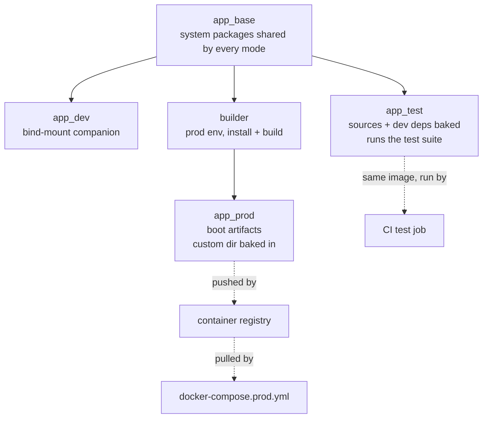

# Suggested setup and usage

> **Scope:** a recommended repository layout for projects running on these images — one multi-target `Dockerfile`, a dev compose that bind-mounts your sources, a prod compose that runs pushed images behind an outer proxy, and test suites that run in containers. The image mechanics (entrypoint modes, `/container/custom`, markers, variables) are documented once in [Shared Concepts](./common.md); the per-variable reference lives in each [image doc](../README.md#available-images). Nothing here is required — every piece is optional, but together they cover dev, test and prod without a host toolchain.

## The idea

One image recipe, several targets. The same `Dockerfile` produces a dev image (your repo bind-mounted over it at runtime), a test image (sources and dev dependencies baked in) and a prod image (build artifacts plus your customization directory baked in). Docker compose selects the target per environment, so dev and prod share one definition instead of drifting apart in two files. Tests run inside the test target — contributors and CI need nothing but Docker.



## Repository layout

```
.
├── Dockerfile                  # one file, four targets
├── docker-compose.yml          # dev: builds the dev target, bind-mounts sources
├── docker-compose.prod.yml     # prod: runs pushed images, no published ports
├── docker/
│   ├── app/                    # your /container/custom: nginx snippets,
│   │                           # entrypoint hooks, env files
│   └── certs/                  # optional TLS certs for local https (gitignored)
└── .github/workflows/deploy.yml  # tests → build & push → deploy webhook
```

The `docker/app` directory is the project's [`/container/custom`](./common.md) content: NGINX snippets, entrypoint hooks, env files. Dev bind-mounts it; prod bakes it into the image. Both environments consume the same files, so a snippet change is testable in dev and ships with the image in prod.

## The multi-target Dockerfile

Worked example for a Node app on `neunerlei/node-nginx`. The shape is identical for the other images — see [adapting to other images](#adapting-to-other-images).

```dockerfile
# ── Shared base ──────────────────────────────────────────────────────────────
# System packages EVERY mode needs (dev, test, prod). Kept first: it changes
# rarely and everything below builds on its cache.
FROM neunerlei/node-nginx:24 AS app_base
RUN apt-get update \
    && apt-get install -y --no-install-recommends <your-runtime-tools> \
    && rm -rf /var/lib/apt/lists/*

# ── Dev ──────────────────────────────────────────────────────────────────────
# The dev compose bind-mounts the repository over /var/www/html and runs the
# dev server via the web command. Usually starts empty — the target exists so
# dev/prod differ explicitly and has room to grow (debuggers, extra CLIs).
FROM app_base AS app_dev

# ── Test ─────────────────────────────────────────────────────────────────────
# Sources + FULL install (dev dependencies included) baked in, so the test
# service (and CI) runs the suite without touching any host toolchain.
FROM app_base AS app_test
COPY --chown=www-data:www-data . .
RUN init-build-env --allow-boot
RUN pnpm install --frozen-lockfile

# ── Builder for prod ─────────────────────────────────────────────────────────
# init-build-env runs the entrypoint in build mode: production environment,
# services skipped — later RUNs see exactly the variables production will have.
# The builder is never booted; its artifacts are copied into app_prod.
FROM app_base AS builder
COPY --chown=www-data:www-data . .
RUN init-build-env
RUN pnpm install --frozen-lockfile && pnpm build && pnpm prune --prod

# ── Prod ─────────────────────────────────────────────────────────────────────
# Boot artifacts only, plus docker/app baked into /container/custom — the
# image is self-contained and needs no writable custom mount at runtime.
FROM app_base AS app_prod
WORKDIR /var/www/html
COPY --from=builder --chown=www-data:www-data /var/www/html/build ./build
COPY --from=builder --chown=www-data:www-data /var/www/html/node_modules ./node_modules
COPY --from=builder --chown=www-data:www-data /var/www/html/package.json ./
COPY --chown=www-data:www-data docker/app /container/custom
ENV NODE_WEB_COMMAND="node /var/www/html/build/index.js"
```

Three mechanics carry the weight:

- **`init-build-env`, not a bare `RUN /container/entrypoint/entrypoint.sh`.** The bare form is deprecated. `init-build-env` writes a build-mode marker, and an image carrying that marker refuses to boot — deliberately, so a builder stage can never ship as a final image. A test target *is* booted (the container runs the suite), which is exactly what `--allow-boot` is for: build-time environment, no boot refusal.
- **Mount in dev, bake in prod.** The bind mount keeps snippet and hook edits live without rebuilds. Baking makes the prod image self-contained: deploys pull an image, not a repository checkout, and the entrypoint never needs write access to the custom dir.
- **Dependencies before sources.** Keep lockfile-only `COPY` + install ahead of the source `COPY` where your toolchain allows it, so source edits do not invalidate the dependency layers.

## The dev compose

```yaml
services:
  app:
    build:
      context: .
      target: app_dev
    restart: no
    volumes:
      # Live sources: the container runs your working copy.
      - ./:/var/www/html
      # The custom dir from the repo (prod bakes the same directory in).
      - ./docker/app:/container/custom
      # Persistent state (database files, uploads — whatever your app keeps).
      - app_data:/data
    environment:
      ENVIRONMENT: dev
      # Container processes run with your uid/gid, so writes into the bind
      # mount (node_modules, caches) land with host ownership.
      PUID: ${PUID:-1000}
      PGID: ${PGID:-1000}
      # Dev server port + command; the quoting keeps the && chain in ONE sh
      # argument (the supervisor template shlex-splits the value).
      NODE_SERVICE_PORT: '5173'
      NODE_WEB_COMMAND: "sh -lc 'pnpm install && pnpm dev --host'"
    ports:
      # Localhost only — dev servers have no place on a LAN.
      - '127.0.0.1:5173:5173'
    extra_hosts:
      - host.docker.internal:host-gateway

  # ── Test services ────────────────────────────────────────────────────────
  # Sources and dependencies are baked into the target — no mounts, no host
  # toolchain. Run with `run --rm` (not `up`) so the exit code propagates.
  node-test:
    build:
      context: .
      target: app_test
    profiles: ['test']
    restart: no
    command: sh -lc 'pnpm check && pnpm test'

volumes:
  app_data: {}
```

`restart: no` is deliberate: a dev container that dies should stay dead and visible, not silently restart under a healthcheck. Reaching a host service (a local database, an LLM provider) from inside the container works through `host.docker.internal`.

## Test strategy

The test target turns the suite into a container invocation:

```sh
docker compose --profile test run --rm node-test
```

What this buys:

- **No host toolchain.** A fresh checkout plus Docker runs the whole suite — the exact node/php/python version, the exact system packages. CI needs no setup steps either, just build and run.
- **Same image shape in CI and locally.** CI runs the identical container a contributor runs, against the identical baked environment.
- **Heavy dependencies are fine.** Browser-based e2e suites work when the test target installs the browser (add `RUN playwright install …` to the base or test target) — give the service `shm_size: 1gb` so the browser does not crash on the small default `/dev/shm`.

> **Why `run --rm` and not `up`?** `docker compose run` propagates the container's exit code, so scripts and CI fail when the suite fails. `up` starts the service but reports compose's own exit status — a green pipeline with a red suite. The `test` profile keeps the services out of plain `docker compose up`.

Multiple suites get multiple services (`node-test`, `python-test`, …) with one target each — or a single test target aliased per suite if their content is identical.

## The prod compose

```yaml
services:
  app:
    # Provided by the environment (CI pushes, the deploy platform pulls).
    # Build locally with: docker build --target app_prod -t myapp:prod .
    image: ${APP_IMAGE}
    restart: always
    volumes:
      # State only — code and config are baked into the image.
      - app_data:/data
    env_file:
      - .env
    environment:
      # Match whatever wrote /data first (typically the dev stack's ids).
      PUID: ${PUID:-1000}
      PGID: ${PGID:-1000}
    healthcheck:
      test: curl --fail http://localhost/api/health || exit 1
      interval: 30s
      timeout: 10s
      retries: 3
      start_period: 30s
    networks:
      - default
      - proxy-network

networks:
  # Created by the outer proxy (Traefik, Dokploy, …) — external here.
  # No ports are published: the proxy routes to the container over this
  # network and terminates TLS.
  proxy-network:
    external: true

volumes:
  app_data: {}
```

The notable property is what is absent: no `ports`, no bind mounts of code or config. The image carries everything; the platform provides routing, TLS and env. Worker processes (queues, schedulers) are additional services reusing the same image with a [`*_WORKER_COMMAND`](./common.md) instead of the web stack.

## Wiring it into CI

A minimal pipeline around the two composes:

```yaml
jobs:
  test:
    runs-on: ubuntu-latest
    steps:
      - uses: actions/checkout@v7
      - run: docker compose --profile test build node-test
      - run: docker compose --profile test run --rm node-test

  build-and-push:
    needs: test
    runs-on: ubuntu-latest
    permissions:
      contents: read
      packages: write
    steps:
      - uses: actions/checkout@v7
      # Registries require lowercase image paths; ${GITHUB_REPOSITORY} may
      # contain uppercase letters in the owner name.
      - id: repo
        run: echo "name=${GITHUB_REPOSITORY,,}" >> "$GITHUB_OUTPUT"
      - uses: docker/login-action@v4
        with: { registry: ghcr.io, username: '${{ github.actor }}',
                password: '${{ secrets.GITHUB_TOKEN }}' }
      - uses: docker/build-push-action@v7
        with:
          context: .
          target: app_prod        # the deployable image is never the default
          push: true
          tags: |
            ghcr.io/${{ steps.repo.outputs.name }}:${{ github.sha }}
            ghcr.io/${{ steps.repo.outputs.name }}:latest

  deploy:
    needs: build-and-push
    runs-on: ubuntu-latest
    steps:
      - run: curl -fsSL '${{ secrets.DEPLOY_WEBHOOK }}'
```

Push on `main`, let the deploy platform's webhook pull the fresh tag, done. The `:latest` tag is convenience for local runs; the sha tag is what production should pin. A retention action (keep N most recent) keeps the registry from growing unbounded.

## Adapting to other images

| Concern | node-nginx | php-nginx | python-nginx |
|---|---|---|---|
| Web process | `NODE_WEB_COMMAND`, `NODE_SERVICE_PORT` | PHP-FPM, automatic | `PYTHON_APP_MODULE` + gunicorn vars |
| Dependency install | `pnpm install --frozen-lockfile` | `composer install` | `gosu www-data pip install -r requirements.txt` |
| Test command | `pnpm test` | `phpunit` / `pest` | `pytest` |
| Build-mode env for tests | `init-build-env --allow-boot` | same | same |

The target structure, the mount-vs-bake split, the test profile and the prod compose shape stay as they are — only the install/build commands and the web-process variables change.

## Where to go next

| I want to… | Read |
|---|---|
| Understand modes, `/container/custom`, markers, templating | [Shared Concepts](./common.md) |
| Look up image variables | The [image doc](../README.md#available-images) for your runtime |
| Read the background on `init-build-env` | [Build mode migration](./migration/2026-11-12-build-mode-marker-and-variables.md) |
| Contribute to the images themselves | [Contributing](./contributing.md) |
