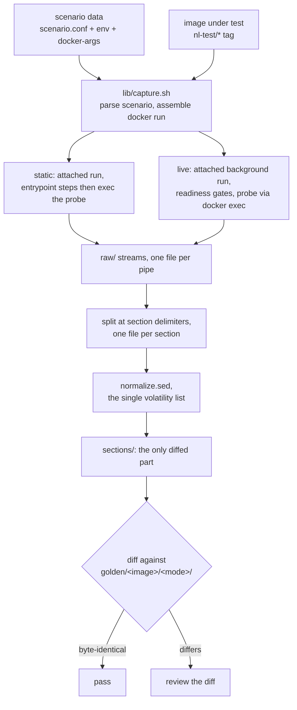

# The test suite

The repository ships a three-tier test suite under top-level `tests/`: unit tests against the real entrypoint functions, golden captures of every scenario's rendered output, and integration tests against live containers. Bash and [bats-core](https://github.com/bats-core/bats-core) end to end. It runs on any machine with Docker and in CI as a pull-request guard.

> **Scope:** how the suite works and how to extend it. What it verifies — the entrypoint, container modes, customization, read-only operation — is documented once in [Shared Concepts](./common.md); repository conventions live in [Contributing](./contributing.md).

## Why the images are testable

The images are configured entirely through environment variables and mounts: the entrypoint reads the environment on every boot, renders every config file from templates, and finally `exec`s the container command. Two properties of the code turn that into testability:

- The entrypoint runs all of its steps and then `exec`s whatever command it receives. Hand it a probe instead of a service, and the complete post-boot state is observable from inside the container. No image modification, no test hooks in shipped code.
- `util.d/` and `legacy.d/` are function libraries. Nothing executes at source time, so tests can source the shipped files and call real functions directly, in the exact environment the image provides.

The suite never modifies image sources to make things testable. Everything it observes is reachable through env vars, mounts and `docker run`.

## The three tiers

| Tier | Command | What it checks | Why this shape |
|---|---|---|---|
| Unit | `tests/run.sh unit` | Real functions from `util.d/`/`legacy.d/`, plus the legacy-layer mapping check | Fast and precise: a function contract breaks, one test goes red. Runs inside the image so the functions see their production dependencies. |
| Golden | `tests/run.sh golden` | The full rendered surface: boot log, nginx config, supervisor config, env snapshot, ownership, checksums | A scenario fixes the inputs (env + mounts); the capture records the outputs. Diffing makes every rendered byte a regression test without per-field assertions. |
| Integration | `tests/run.sh integration` | Live behavior a capture cannot prove: an auth hash actually authenticates, a redirect actually redirects, an abort actually exits 1 | Boots real containers and asserts responses. The scenario data is the same files the golden tier consumes, so both tiers always describe the same boot. |

Bats-core is the only tooling added: a single bash project that runs wherever bash does, no compilation, no host dependencies. The pin (version + sha256) is downloaded on demand and checksum-verified, so the assertion engine cannot drift. The rest is bash driving docker directly. The suite's only network use is image pulls plus that one tooling download.

## Directory anatomy

```
tests/
├── run.sh                      # entry point: tiers, flags, the leftover-container sweep
├── lib/                        # host-side harness
│   ├── helpers.bash            # logging, sweep, readiness gates, the scenario parser
│   ├── build-image.sh          # docker build with release-tooling parity
│   ├── capture.sh              # boot one scenario/mode, collect, split, normalize
│   ├── probe.sh                # runs INSIDE the container, prints the sections
│   ├── normalize.sed           # the single volatility list (see Golden tier)
│   ├── bats.sh                 # pinned bats-core: download, checksum, cache
│   ├── integration-helpers.bash # boot/curl helpers loaded by every expect.bats
│   └── resolve-source-image.js # CI only: resolve the exact SOURCE_IMAGE tag
├── unit/                       # Tier 1: bats files run inside each image
│   ├── helpers.bash            # sandbox + "source the real files" bridge
│   ├── *.bats                  # one file per util.d/legacy.d subject
│   └── fixtures/               # real bind mounts for the mount-guard test
├── scenarios/<name>/           # Tier 2 + 3 input: data, not code
│   ├── scenario.conf           # required declaration
│   ├── env, docker-args, files/, Dockerfile   # optional inputs
│   ├── expect.bats             # optional Tier 3 assertions
│   └── golden/<image>/<mode>/  # recorded capture sections (committed)
├── .cache/                     # gitignored: bats pin, capture caches
└── .parity/                    # gitignored: one-time main-parity workspace (see History)
```

| I want to | Start at |
|---|---|
| run the suite | `tests/run.sh --help` (the header comment is the usage) |
| know what a capture records | `tests/lib/probe.sh`, the section collectors |
| follow a capture from boot to diff | `tests/lib/capture.sh` |
| add or change a scenario | the [scenario reference](#scenarios-are-data-not-code) and any existing `tests/scenarios/*/scenario.conf` |
| decide whether a diff is volatility | `tests/lib/normalize.sed`, every entry carries its reason |
| unit-test a util.d function | `tests/unit/helpers.bash` and an existing `tests/unit/*.bats` |
| assert live behavior | `tests/lib/integration-helpers.bash` and an existing `expect.bats` |
| test a new image in CI | [CI](#ci) |

## Running the suite

```bash
tests/run.sh unit              # Tier 1 + the legacy-layer mapping check
tests/run.sh golden            # Tier 2: capture every scenario, diff against goldens
tests/run.sh golden --update   # re-record goldens (only after reviewing a diff)
tests/run.sh integration       # Tier 3: expect.bats on the host, live containers
tests/run.sh all               # the three tiers in order
tests/run.sh bats-pin          # ensure the pinned bats-core exists (CI warm-up)
```

Global flags go before the subcommand; anything after the subcommand is forwarded to it (currently `golden`'s `--update`).

| Flag | Effect |
|---|---|
| `--only-image <name>` | Restrict every tier to one image. Validated against the suite's image list, so a typo fails loudly instead of silently running nothing. |
| `--image <name>=<ref>` | Use a pre-built tag for that image (repeatable). Iterate on tests without rebuilding. |
| `--tree <path>` | Source tree the default images build from (default: this checkout). Point it at a worktree to build another branch with the same tooling. |
| `--label <name>` | Suffix for test container names and tags. Keeps parallel sessions out of each other's way. |
| `--force-build` | Rebuild the default images even when the tag exists locally. |

Every container and image the suite creates carries the `nl-test/` prefix or the `nl-test=1` label, and `run.sh` sweeps labeled leftovers before and after each run. Local test images are always tagged `nl-test/<image>:...`, never `neunerlei/*`: a local `neunerlei/nginx` tag would shadow the registry image for every other project on this machine that builds `FROM neunerlei/...`. The build library refuses such tags outright.

## Building the images under test

`tests/lib/build-image.sh` mirrors the release tooling's `docker build` invocation exactly: build from the resolved version directory, `--build-context common=<tree>/src/_common`, `--progress=plain`, `--build-arg SOURCE_IMAGE=<ref>`. That parity is the point: what the suite tests must be what the publish pipeline ships, byte for byte in tooling.

The version-directory fallback behaves like the release tooling's path resolution: the requested version maps to the newest version directory that is not newer than the request, so `php-nginx 8.5` builds from the `8.2` directory while consumers can already ask for 8.5. `latest` resolves to the newest directory.

The `SOURCE_IMAGE` base image tag has two derivation paths:

- Locally (the default path in `run.sh`): derived from the source-image table in `build-image.sh` as `<namespace>/<name>:<version>-<filter>`, mirroring the publish workflow's inputs. The table is kept in sync with those workflows by hand. No registry tag listing happens here; `docker build` fails loudly when the derived tag does not exist.
- In CI: `tests/lib/resolve-source-image.js` calls the release tooling itself (`docker-version-utils.js`, the same tag-discovery chain the publish pipeline uses) and hands the resolved exact tag to `--source-image`. Version logic exists once, in the release tooling.

Builds are pinned to `linux/amd64`. The release images publish multi-platform, but captures must be comparable on every development machine, so the suite fixes the architecture instead of matching the host.

## The capture pipeline



The probe (`tests/lib/probe.sh`) is bind-mounted read-only at `/nl-test/`, a neutral path the image knows nothing about. It is never baked into the image, which is what lets the same probe run against any build and makes captures comparable at all.

The probe prints its observations as delimited sections on stdout, one delimiter line per section: `===== nl-test-section: <name> =====`. The delimiter doubles as the file name in the capture directory. A delimiter appearing on stderr is a probe bug and fails the capture loudly; a failing collector degrades to a marker line inside its section, never to a truncated capture.

The two modes answer different questions:

- **Static**: `docker run` attaches the container and passes the probe as the command. The entrypoint runs every step, then `exec`s the probe, so the container filesystem is in the exact post-boot state. Everything before the first delimiter on each stream is the entrypoint's own boot log, recorded as the `stdout`/`stderr` sections; the command's exit code becomes the `exit-code` section.
- **Live**: the container boots normally (the entrypoint `exec`s supervisord), and the probe runs afterward via `docker exec` alongside the services. Static sections are captured the same way, plus the live-only ones. The boot runs attached in the background rather than detached with a later `docker logs`: docker logs merges the container's stdout and stderr pipes, and the interleaving of two pipes is scheduler-dependent. Attached, each stream lands in its own single-pipe file and stays order-deterministic.

Live captures poll readiness in gates, in order:

1. Every supervised program reports RUNNING (`wait-running=false` swaps in a soft gate that only waits until supervisorctl is reportable at all, for scenarios where programs legitimately stay in BACKOFF/FATAL).
2. HTTP answers with any response. The poll accepts 4xx/5xx on purpose: a 401 from an auth scenario proves readiness just as well as a 200. `wait-http=false` skips this gate for scenarios without a web server.
3. The stability window (`stability=<seconds>`), opt-in: a bounded poll that records whether the container stayed up, as a verdict in `stability.txt`.

Gating on the supervisor state transition before polling HTTP keeps the boot log causal: boot lines, RUNNING lines, then request lines. That ordering is what makes the logs sections byte-stable.

The captured section set is the capture format:

| Section | Mode | Content |
|---|---|---|
| `argv` | both | The arguments the command received, one per line |
| `nginx-T.conf` | both | Fully expanded nginx configuration |
| `supervisor.conf` | both | Main supervisor config plus every conf.d program, sorted |
| `image-config.txt` | both | Rendered image-specific config (gunicorn, php ini/fpm) |
| `vars.sh` | both | The exported variable snapshot for later RUN steps. Holds UNMASKED values by design. |
| `passwd` | both | The www-data entry and id resolution |
| `ownership.txt` | both | Owner/group/mode of the user-owned directories, sorted, no timestamps |
| `work-data.checksums` | both | Sorted md5 list of the work data |
| `htpasswd.txt` | both | Generated basic-auth password files (hashes normalized) |
| `exit-code` | static | The container command's exit code |
| `stdout`, `stderr` | static | The boot-log preamble per stream |
| `supervisor-status` | live | `supervisorctl status` |
| `process-env` | live | Per program: user, group, HOME from the process itself |
| `exec-shell-env` | live | HOME/identity of the exec context (plain shell and `gosu www-data` CLIs) |
| `http.txt` | live | Status line and behavior headers of the probed paths |
| `logs`, `logs-stderr` | live | The container's own streams, boot log included |
| `probe-stdout`, `probe-stderr` | live | Normally empty preambles of the exec'd probe |

After splitting, every section goes through one normalization pass with `tests/lib/normalize.sed`, and the recorded goldens go through the same pass at `--update` time, so both sides of every diff are normalized identically. Nothing is normalized anywhere else in the suite.

## Scenarios are data, not code

A scenario is a directory under `tests/scenarios/<name>/`. The tiers read the same data, so a scenario declared once is captured in Tier 2 and asserted in Tier 3. Everything except `scenario.conf` is optional:

| File | Required | Role |
|---|---|---|
| `scenario.conf` | yes | Key=value declaration, parsed into the `SCENARIO_*` contract |
| `env` | no, auto-detected | Passed to `docker run --env-file`; values are taken verbatim, no shell quoting |
| `docker-args` | no, auto-detected | Extra `docker run` arguments, one shell-expanded line each; `${SCENARIO_DIR}` resolves to the scenario dir |
| `files/` | no | Content to bind-mount; mount lines in `docker-args` reference it via `${SCENARIO_DIR}` |
| `Dockerfile` | no | Build-time scenario: built ON TOP of the image under test (`ARG BASE` / `FROM ${BASE}`), the derived image is captured |
| `expect.bats` | no | Tier 3 assertions; its presence opts the scenario into the integration tier |
| `golden/<image>/<mode>/` | recorded | The Tier 2 expected sections for this image and mode |

A minimal complete `scenario.conf`:

```bash
# tests/scenarios/<name>/scenario.conf — key=value lines, '#' comments.
images=nginx               # images this scenario runs on (space separated)
modes=static live          # capture modes (default: "static live")
http-probe=/               # extra live GET paths, repeatable; "/" is always probed
```

The full key reference (parsed in `nl_parse_scenario_conf`, `tests/lib/helpers.bash`; unknown keys fail the run):

| Key | Meaning |
|---|---|
| `images` | Space-separated image names the scenario applies to |
| `modes` | Capture modes, default `static live` |
| `env` | Env file, relative to the scenario dir (default: `env` when present) |
| `docker-args` | Docker-args file, relative to the scenario dir (default: `docker-args` when present) |
| `legacy-layer` | `legacy.d/` file name(s) this scenario covers; checked by the mapping check |
| `http-probe` | Repeatable. Extra GET paths for the live HTTP section (default: `/`) |
| `command` | Container command, shell-quoted so argument boundaries stay exact |
| `command-mode` | `probe` (default) or `container`, see below |
| `dockerfile` | Scenario Dockerfile to build on top of the image under test |
| `wait-http` | `false` skips the HTTP readiness gate (worker scenarios) |
| `wait-running` | `false` swaps the strict all-RUNNING gate for the soft reportable gate |
| `stability` | Seconds of bounded stay-up poll after readiness; verdict in `stability.txt` |
| `timeout` | Capture timeout in seconds for this scenario (an explicit `--timeout` flag wins) |

The `command` mechanics deserve their why. By default (`command-mode=probe`), the capture runs `/nl-test/probe.sh static <command...>` as the container command: the entrypoint execs the probe, and the scenario command rides along as the probe's `argv` section. The legacy single-string fallback, however, only triggers when the first command argument is not an executable, and the probe path is an executable. A scenario that needs to observe that fallback therefore declares `command-mode=container`: the scenario command IS the container command, and the capture is the boot log plus the command's own stdout, stderr and exit code, which is precisely the observable there.

## Tier 1: unit

The pinned bats-core (version and sha256 in `tests/lib/bats.sh`) is downloaded on demand into the gitignored `tests/.cache/` and reused from there. Host and container use the same pin, so an assertion can never pass on the host and fail inside the image because of a bats version difference.

Unit tests run INSIDE a throwaway container per image rather than on the host, because the functions under test mutate the filesystem (compat bridges symlink real paths, auth files are written, work-data syncs move directories) and need the image's production dependencies: `findmnt`, `openssl`, `gosu` and the www-data user. The tests and bats are bind-mounted read-only at neutral `/nl-test/*` paths, so nothing of the suite can be mutated.

The image entrypoint is bypassed (`--entrypoint /bin/bash`): a boot would run all entrypoint steps and dump their log into the TAP stream. Instead, each test sources the real shipped files from `/container/entrypoint/util.d/` and `legacy.d/` and sets up exactly the environment the function contract requires. A drift between tests and shipped code is impossible; the unit under test is the file the image ships.

`tests/unit/helpers.bash` provides the bridge: `nl_unit_source` sources a real implementation file, `nl_unit_sandbox` creates a fresh per-test directory under /tmp that `nl_unit_teardown` removes, and `nl_unit_capture_stderr` runs a command in-process. The last one exists because bats' `run` executes in a subshell, which would swallow the global mutations the legacy fallbacks perform (they rewrite the global `entrypoint_command` array; capturing that mutation IS the assertion).

The unit container also gets a real host bind mount at `/etc/ssl/certs` (from `tests/unit/fixtures/`), so the legacy mount guard can classify an actual mount by findmnt's SOURCE shape rather than a simulated one. Hiding the CA bundle is harmless: unit tests make no network use.

The tier opens with the legacy-layer mapping check (`nl_check_legacy_layer_coverage` in `run.sh`), before any container starts. It is static repository data, costs nothing, and enforces the mapping in both directions: every file in `legacy.d/` must be referenced by at least one scenario's `legacy-layer=` tag, and every such tag must point at an existing file. A layer cannot land without a scenario exercising it, and removing a layer forces its scenarios to be removed with it. A layer's `until:` date is permission, not obligation: removal is allowed any time after it, an untouched layer may stay longer.

## Tier 2: golden

A golden is the `sections/` output of one capture, committed under `golden/<image>/<mode>/` inside the scenario directory. The cells are per image because the per-image overlays (a php ini template, a node service file, a proxy snippet) are exactly what drifts between images; the duplication is cheap and each diff reads in image context.

Recording is deliberate, never incidental: run the tier, review the diff it reports, and only then `tests/run.sh golden --update`. The goldens are reviewed like code in PRs. Never re-record to make a red run green without understanding the diff.

The determinism contract: `tests/run.sh golden` twice in a row must be green both times, on any machine. A red second run means something volatile leaked into a capture. The fix is in the probe or in `normalize.sed`, never in an edited diff. Two mechanisms keep captures stable:

- Normalization. `tests/lib/normalize.sed` is the ONLY place volatile values are normalized, one commented entry per volatility class: resolver addresses (normalized by context, not by value), salted password hashes, PIDs, log timestamps, certificate material. Every entry states what is volatile and why; adding an entry to make a diff disappear is the one forbidden move. Values that would only pollute are dropped at the source instead (the HTTP collector keeps behavior headers and discards `Date`).
- Sorting at the source. Unordered output (variable snapshots, find listings, checksum lists, conf.d files) is sorted in the probe before it is written, not normalized afterward.

Scenario credentials are throwaway. Clear passwords appear unmasked in the captured variable snapshot by design: that snapshot exists to hand real values to later RUN steps, so masking it would lie about the image's behavior. Only synthetic values may therefore ever appear in a scenario env file.

## Tier 3: integration

Integration scenarios carry an `expect.bats`, and the pinned bats runs ON THE HOST over each scenario-image combination (selected via `NL_TEST_*` environment variables that `run.sh` hands over). The assertions are plain bats tests backed by `tests/lib/integration-helpers.bash`:

```bash
#!/usr/bin/env bats
load '../../lib/integration-helpers'

setup()         { nl_int_load_state; }  # reload boot facts in each test process
setup_file()    { nl_int_boot; }        # boot the scenario's live container once
teardown_file() { nl_int_teardown; }    # remove containers + state file

@test "GET / without credentials answers 401" {
    [ "$(nl_int_curl_status "/")" == "401" ]
}
```

The state-file hand-off is the one non-obvious mechanism. bats runs `setup_file`, every `@test`, and `teardown_file` in separate bash processes, so variables set during the boot are invisible to the tests. The boot helpers therefore write their facts (container name, static exit code, stream dir) as key=value lines to a small state file under /tmp, and each test's `setup()` loads it back via `nl_int_load_state`. Values never contain `=`: container names are sanitized, exit codes are numeric, paths are plain.

Container lifecycle mirrors the capture harness: `nl_int_boot` starts the container detached with the scenario's env and docker-args, then applies the same readiness gates the live captures use. Scenarios whose observable is an abort use `nl_int_run_static` instead: an attached run whose exit code and streams are recorded. Every container carries the `nl-test=1` label, teardown removes containers and state files, and the `run.sh` sweep catches anything a hard kill leaves behind.

All waiting is bounded polling with deadlines, never fixed sleeps. Curl runs inside the container (`docker exec`), so there is no host port mapping and no port juggling: identical answers on every machine. Helpers cover status codes and response headers, with optional basic-auth credentials, which is how the auth matrix (401 without credentials, 200 with the right ones, 401 for a wrong password) is asserted against the live server.

## CI

CI is a pull-request guard only. There is deliberately no push or schedule trigger: the publish pipelines own push and scheduled builds, and the test suite never pushes images or touches registry credentials.

`.github/workflows/tests-engine.yml` is the reusable engine, the counterpart of the release `build-engine.yml`: checkout, resolve the exact `SOURCE_IMAGE` tag through the release tooling, buildx build (amd64, GitHub Actions cache scoped per image and week, `nl-test/*` tag, no push), warm the bats pin, then run all three tiers via `run.sh --only-image <image>`.

Each image has one thin caller, `tests-<image>.yml`, triggering on `pull_request` with global paths (`src/**` and `tests/**`): a common-layer or test-harness change must test every image. Adding the test workflow for a new image means copying one caller file, adjusting its `with:` block (the same source-image values its publish workflow passes; `source-image-version` is the newest version directory and bumps together with it), then adding the image to `SUITE_IMAGES` in `tests/run.sh` and to the source-image table in `tests/lib/build-image.sh`. The legacy `src/php/` images are out of scope and have no test workflow.

## History

> **History note:** the suite was built alongside the `feature/basic-auth` branch. Before the goldens were recorded, a one-time main-vs-branch parity run validated the branch: the capture tooling ran every scenario against a main build and a branch build (synthetic scenarios plus real consumer setups), and every diff was reviewed against an explicit expected-diffs allowlist, with a run-over-run determinism check on top. That workspace lives gitignored under `tests/.parity/` and is not part of the committed suite; the same comparison remains re-runnable against any two tags via `--tree` and `--image`. The design rationale lives in `docs/proposals/2026-11-12-test-suite-implementation-plan.md`.
